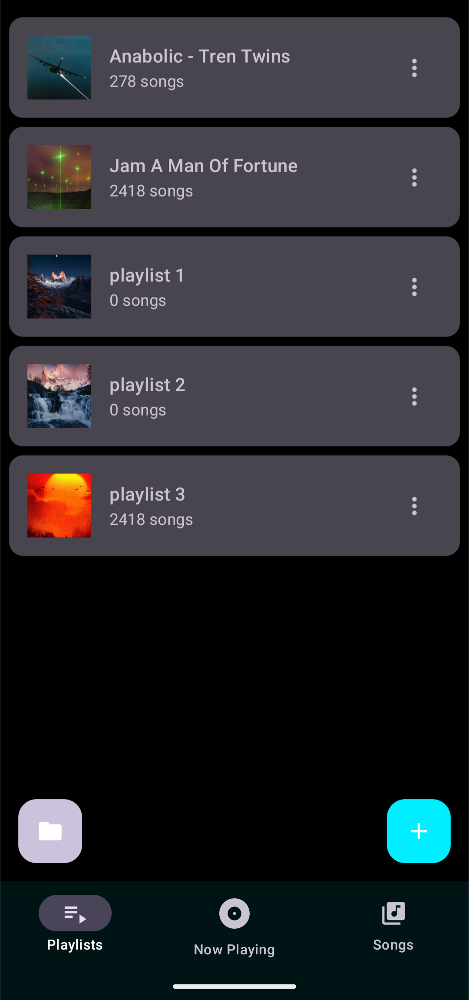
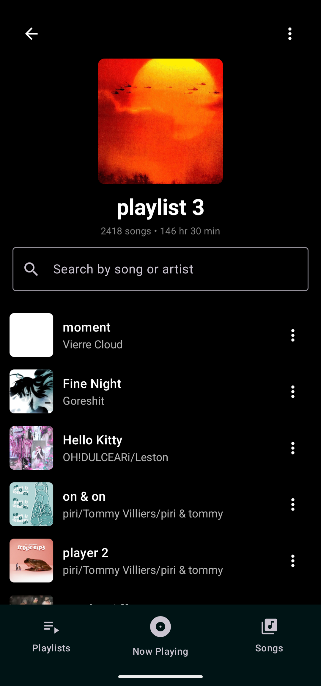
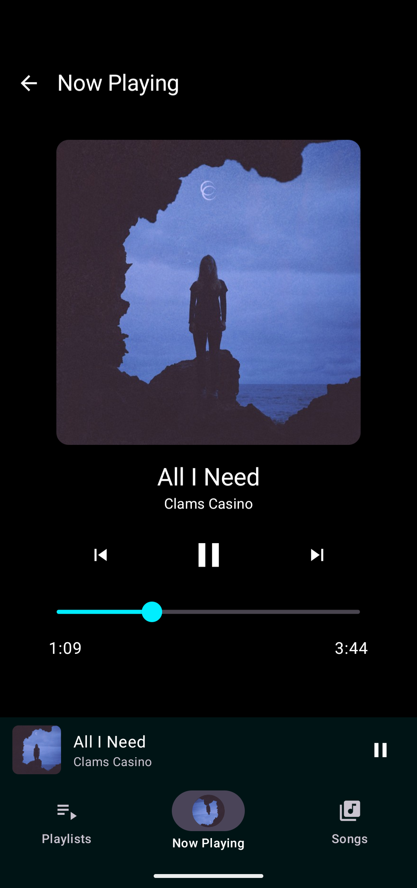
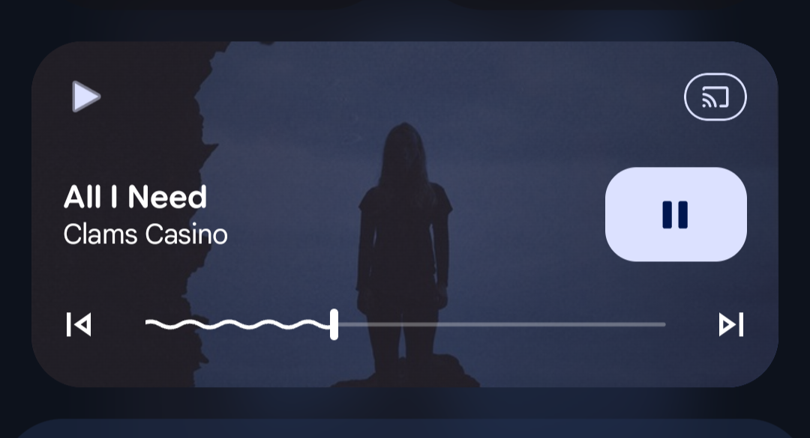

# Android Media Player


A lightweight Kotlin-based Android media player designed to scan local audio files, manage playlists, and provide a clean, modern playback experience. Built with Jetpack Compose and tested on the Google Pixel 7a for complete offline listening.

> **Note:** The app name and branding are temporary and will be updated once the final logo and identity are chosen.

---

### Features

- **Local music scanning** using Android’s MediaStore to load audio files from the device.
- **Playlist creation & management** with custom ordering and persistent storage.
- **Folder import** allowing users to turn any folder into a playlist.
- **Now Playing screen** showing artwork, track info, seek bar, and playback controls.
- **Background playback** with a media session and persistent notification.
- **Spotify‑style notification controls** including play/pause, skip, and artwork.
- **Modern UI** fully built with Jetpack Compose.

---

### Screens & UI Flow

- **Library** – Displays all detected songs.
  
  
- **Playlists** – Create, rename, delete, and reorder playlists.
  
  
- **Now Playing** – Artwork, scrubber, and playback controls.
  
  
- **Notification Control** -
  
  
- **Folder Picker** – Import songs from a selected folder.

---

### Tech Stack

- **Language:** Kotlin  
- **UI:** Jetpack Compose  
- **Architecture:** ViewModel + state-based UI  
- **Media:** Android `MediaPlayer`  
- **Storage:**  
  - MediaStore for scanning  
  - JSON files for playlist persistence  
- **Navigation:** Compose Navigation  
- **Minimum SDK:** 26  
- **Target SDK:** 34  

---

### Project Structure

```
app/
 ├── data/
 │    ├── models/        # Song, Playlist, etc.
 │    ├── repository/    # MediaStore + playlist storage
 │
 ├── ui/
 │    ├── screens/       # Home, Playlists, NowPlaying
 │    ├── components/    # Reusable composables
 │
 ├── player/
 │    ├── MediaPlayerController.kt
 │    ├── NotificationManager.kt
 │
 ├── utils/
 │    ├── FileUtils.kt
 │    ├── Permissions.kt
```

---

### Permissions

- **READ_MEDIA_AUDIO** (Android 13+)  
- **READ_EXTERNAL_STORAGE** (older versions)  
- **POST_NOTIFICATIONS** (for media controls)

These are required for scanning songs and showing playback notifications.

---

### Building & Running

1. Clone the repo:
   ```bash
   git clone https://github.com/Aron-Judge/AndroidMediaPlayer
   ```
2. Open in Android Studio (Hedgehog or newer recommended).  
3. Build & run on a physical device for best audio testing.

---

### What I Learned

Developing this project gave me practical experience with:

- Jetpack Compose UI development
- Android MediaStore integration
- State management and reactive UI updates
- Media sessions and background playback
- Application architecture using ViewModels
- Git and GitHub workflows
- Debugging and testing Android applications

---

### License

```
Copyright (c) 2026 Aron

All rights reserved.

Permission is granted to download and use the compiled application for personal, non-commercial use.

You may not copy, modify, merge, publish, distribute, sublicense, or create derivative works based on the source code or any part of this project.

You may not upload, redistribute, or repackage this software as your own work, whether modified or unmodified.

The source code is provided for reference only. No permission is granted to reuse it in other projects.

This software is provided "as is", without warranty of any kind.
```
